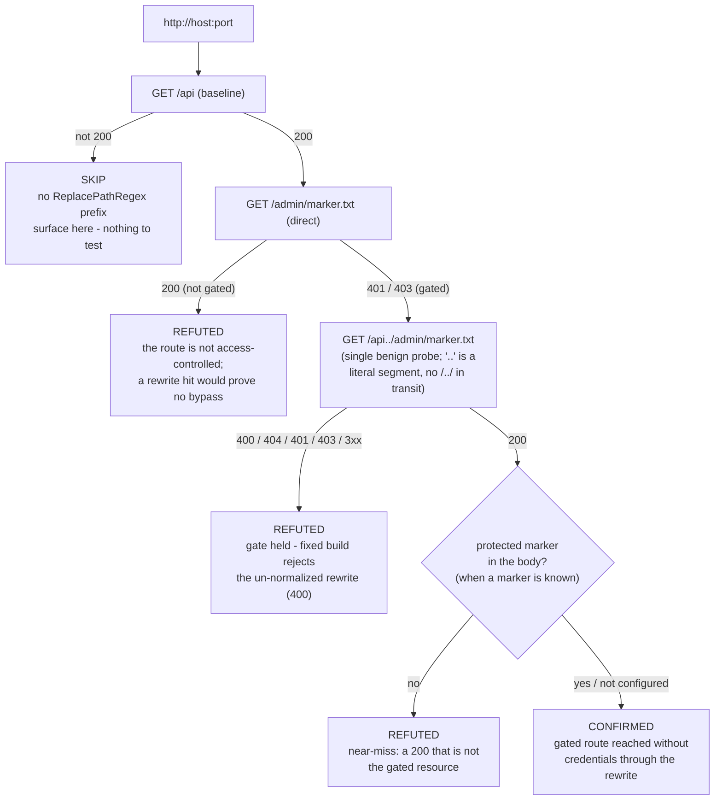

# Traefik ReplacePathRegex path-traversal auth bypass (CVE-2026-65600)

**Template:** [`traefik-replacepathregex-auth-bypass.py`](../../templates/web/auth-bypass/traefik-replacepathregex-auth-bypass.py)
**Class:** reverse-proxy routing / broken access control · **Target kind:** `http` · **Oracle:** `property` (behavioural flip)
**CVE:** [CVE-2026-65600](https://nvd.nist.gov/vuln/detail/CVE-2026-65600) · [GHSA-cxjq-mrr5-89rv](https://github.com/advisories/GHSA-cxjq-mrr5-89rv) · **CWE-22**

| Signal | The question it answers |
|---|---|
| Direct gate | Is the protected route actually access-controlled when asked for straight? (must be `401`/`403`) |
| Rewrite flip | Does the same route become reachable without credentials once the request passes through the `ReplacePathRegex` prefix router? (`200`) |

Proof harness: [`tests/prove-traefik-replacepathregex-auth-bypass.sh`](../../tests/prove-traefik-replacepathregex-auth-bypass.sh).
Synthetic lab: [`tests/fixtures/traefik-replacepathregex/`](../../tests/fixtures/traefik-replacepathregex/).

---

## 1. Use case

Traefik's `ReplacePathRegex` middleware rewrites a request path with a regular
expression before the request is forwarded to the backend. A common shape exposes
an internal service under a public prefix: match `^/api(.*)`, replace with `/$1`,
so `/api/orders` reaches the backend as `/orders`. Teams lean on this to put one
router — unauthenticated — in front of the public surface, and a *second* router,
behind `basicAuth` or `forwardAuth`, in front of an administrative path such as
`/admin`.

CVE-2026-65600 is that the middleware forwards the rewritten path **without
checking whether it still normalizes to itself**. A request to `/api../admin`
carries a single path segment, `api..`, so Traefik's own `sanitizePath` leaves it
untouched and the unauthenticated `PathPrefix(/api)` router matches. The regex then
captures `../admin` and produces `/../admin`. Traefik forwards that verbatim; a
backend that normalizes paths — most application servers and static file servers do
— resolves `/../admin` to `/admin` and serves the protected resource. The
credentialed router that was supposed to gate `/admin` is never on the path. It is
the same omission as [CVE-2026-48020](https://github.com/advisories/GHSA-cxjq-mrr5-89rv)
in `StripPrefix`, whose fix added a post-rewrite normalization check that
`ReplacePathRegex` had not received.

The advisory is precise about the trigger: the exploitable rule is the one **without**
a slash separator, `^/api(.*)`; the slash-anchored `^/api/(.*)` does not match
`/api../admin` and is not affected. Fixed in Traefik **2.11.52**, **3.6.23**, and
**3.7.7**; the fix "rejects any request whose replaced path does not match its
normalized form" and returns `400`.

The defect is not a version string and it is not the presence of the middleware —
`ReplacePathRegex` is a feature, and a slash-anchored rule using it is safe. The
defect is a runtime behaviour: does a dot segment survive the rewrite and reach a
gated route? The only sound way to answer that is to send the request and watch
what the access decision does.

## 2. Testing flow

The template confirms on a **flip observed on the target**, never on a banner. The
probe is one benign `GET`; the `..` is a literal path segment, and it retrieves a
marker file no credentialed client could not already read. It proves the access
decision was skipped — it does not act on the access.

Three preconditions must all hold before the template will confirm: the prefix
router is present (`/api` → `200`), the target route is genuinely gated
(`401`/`403` direct), and the rewrite reaches it (`200`). A route that answers
`200` directly was never gated — the template records that as a refutation with an
observation, not a confirmation; a `200` whose body is not the gated resource is a
near-miss, not a bypass.

## 3. Verified in a loopback lab

Both arms are official images; the backend is a path-normalizing static server
(the advisory's precondition). Run `tests/prove-traefik-replacepathregex-auth-bypass.sh`.

| Target | Image | Direct `/admin` | `GET /api../admin/marker.txt` | Engine verdict |
|---|---|---|---|---|
| Vulnerable | `traefik:v3.7.6` | `401` | `200` + protected marker | **confirmed** (1 finding) |
| Fixed | `traefik:v3.7.7` | `401` | `400 Bad Request` | **refuted** (0 findings) |
| Unrelated | plain static server | — | baseline `/api` → `404` | no finding (template skips) |

## 4. Who else detects this, and why behavioural wins

| Approach | How it decides | Blind spot on this CVE |
|---|---|---|
| Version fingerprinting | Reads a `Server:` header or build string | Traefik does not emit its version on the data path; a header, if any, is trivially disabled, and the flaw depends on the *rule*, not the build alone |
| Config / IaC linting | Greps the dynamic config for `replacePathRegex` without a slash separator | Flags safe deployments (no gated sibling route) and cannot see a config it is not given; no evidence the gate is actually reachable |
| Generic path-traversal scanners | Fire `../` and `%2e%2e` payloads at every endpoint | The trigger here is a *literal* `api..` segment that survives sanitization, not a `/../` sequence; and without the direct-vs-rewrite comparison a `200` is just a `200` |
| **This template (behavioural)** | Establishes the gate (`401` direct), then shows the rewrite flips it to `200` on the same route | Needs a running target, but it reports only a bypass it has observed end to end — the fixed build refutes deterministically |

A static or version check answers "could this be vulnerable?" This template answers
"is a credential-gated route reachable without the credential, right now?" — the
question an operator actually has to act on. The fix is a behaviour change (reject
the un-normalized rewrite), so behaviour is the only thing that separates a patched
proxy from a vulnerable one: the fixed arm returns `400` to the exact request the
vulnerable arm answers `200` to, and the template refutes it with no false positive.

## 5. Remediation

Upgrade Traefik to **2.11.52 / 3.6.23 / 3.7.7** or later. As defence in depth, do
not rely on path-prefix routing alone for authorization, and prefer a
slash-anchored regex (`^/api/(.*)`), which the advisory notes is not affected.
